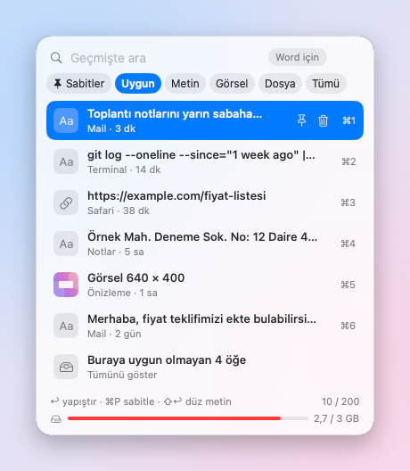
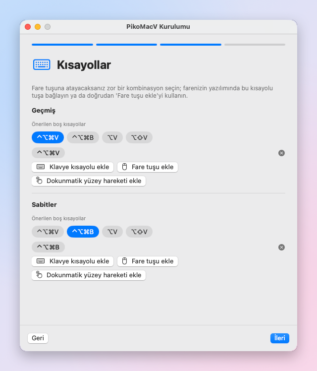
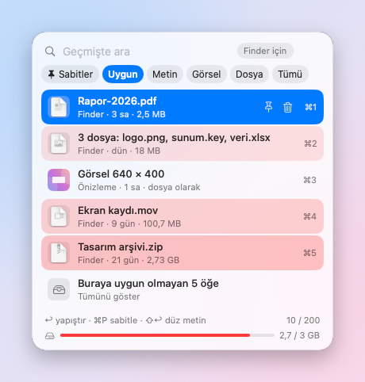
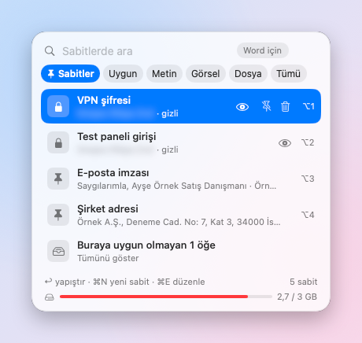
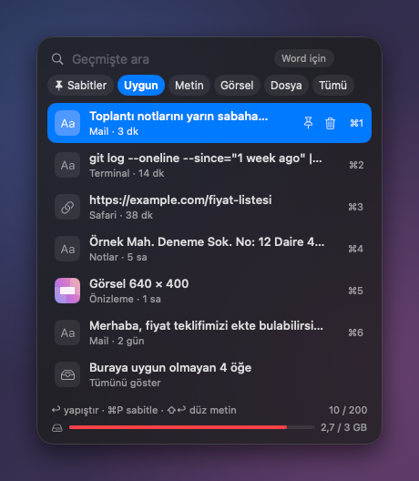

<p align="center"></p>

<h1 align="center">PikoMacV</h1>

PikoMacV, macOS için açık kaynaklı, yerel bir pano geçmişi uygulaması. Windows'taki Win+V penceresine benzer bir panel, kısayola bastığınızda fare imlecinizin olduğu yerde açılır. Kopyaladığınız metin, bağlantı, görsel ve dosyalar burada listelenir; birini seçtiğinizde o an önde olan uygulamaya yapıştırılır. Panel, yapıştıracağınız uygulamaya bakıp yalnızca oraya yapıştırılabilecek öğeleri gösterir. Her şey bu Mac'te kalır, uygulama internete hiç bağlanmaz.



## Özellikler

- Metin, bağlantı, görsel ve dosya geçmişi. Sınır en az 100, varsayılan 200 öğedir; Ayarlar'dan 1000'e kadar çıkarabilirsiniz.
- Bağlama duyarlı "Uygun" sekmesi: yalnızca önde olan uygulamaya yapıştırılabilecekleri gösterir. Word'de dosyalar görünmez; Finder'da dosyalar ve (dosya olarak) görseller görünür; Terminal ve kod editörlerinde metinler görünür, dosyalar yol olarak yapıştırılır.
- Sabitler: sık kullandığınız öğeleri sabitleyin, ayrı bir kısayolla açın.
- Gizli sabitler: listede yalnızca adı ve buzlu bir yer tutucu görünür. İçerik gösterilmeden yapıştırılır, görmek için Touch ID gerekir (oturum varsayılan olarak 2 saat sürer), yapıştırıldıktan 30 saniye sonra panodan temizlenir ve geçmişe girmez.
- Dosya kopyaları: her dosya 100 MB'a kadar, toplam 3 GB'lık depoda tutulur. Depo dolunca en eski kopya silinir; silinmeye yaklaşan satırlar yarı saydam kırmızıya döner. Sabitlenmiş dosyalar silinmez.
- Bir mod için birden çok tetikleyici: klavye kısayolları, fare tuşları ve üç parmakla çift dokunma (dokunmatik yüzey hareketi, yalnızca canlı test geçerse eklenir).
- Kurulum sihirbazı çakışan kısayolları tarar ve boş olanları önerir.
- macOS 26 ve sonrasında yerel "cam" görünümü, macOS 14-15'te klasik yarı saydam görünüm.
- Panel ekran paylaşımında ve ekran kaydında görünmez.
- Parola yöneticilerinden yapılan kopyalamalar geçmişe alınmaz.
- Ağ erişimi yoktur, analiz veya telemetri yoktur.

## Kurulum

Gereksinimler: macOS 14 (Sonoma) veya üzeri; Apple Silicon ya da Intel Mac.

### Tek satırla (önerilen)

Terminal'e şunu yapıştırın:

```bash
curl -fsSL https://raw.githubusercontent.com/atalay111-ux/PikoMacV/main/install.sh | bash
```

Betik şunları yapar:

- GitHub'daki son sürümün `PikoMacV.zip` dosyasını indirir, kod imzasının bozulmadığını doğrular.
- Uygulamayı `/Applications` klasörüne kurar (yazılamıyorsa `~/Applications`), karantina işaretini kaldırır ve uygulamayı başlatır.
- `sudo` kullanmaz, yönetici parolası istemez.

Bir betiği okumadan çalıştırmak istemeyebilirsiniz; [install.sh](install.sh) kısa ve okunabilir.

### Elle kurulum

1. [Releases](https://github.com/atalay111-ux/PikoMacV/releases) sayfasından `PikoMacV.zip` dosyasını indirin.
2. Zip'i açın ve `PikoMacV` uygulamasını Uygulamalar klasörüne sürükleyin.
3. Uygulamayı açın. Apple tarafından onaylanmadığı için macOS ilk açılışı engeller (aşağıya bakın).

**Gatekeeper uyarısı hakkında:** PikoMacV, Apple'ın notarization sürecinden geçirilmemiştir. Bu yüzden elle kurulumda macOS ilk açılışı engeller. Açmak için Sistem Ayarları > Gizlilik ve Güvenlik bölümüne gidin, aşağı kaydırıp PikoMacV için "Yine de Aç" düğmesine tıklayın ve çıkan pencerede yeniden onaylayın. Terminal tercih ederseniz aynı sonucu şu komut verir:

```bash
xattr -dr com.apple.quarantine /Applications/PikoMacV.app
```

Tek satırlık kurulum bu işareti zaten kendisi kaldırır.

## İlk açılış

Uygulama menü çubuğunda bir pano simgesi olarak yaşar, Dock'ta görünmez. İlk açılışta dört adımlı bir kurulum sihirbazı açılır:

1. **Hoş geldiniz:** kısa bir tanıtım.
2. **Erişilebilirlik izni:** seçilen öğenin otomatik yapıştırılması ve fare tuşu tetikleyicileri için gerekir. Şimdilik atlayabilirsiniz; atlarsanız öğe yalnızca panoya konur ve ⌘V'yi siz basarsınız.
3. **Kısayollar:** sihirbaz, sistem kısayollarınızı ve yaygın uygulama kısayollarını tarayıp çakışmayan kombinasyonlar önerir. "Geçmiş" ve "Sabitler" için birer öneri hazır gelir; değiştirebilir, klavye kısayolu, fare tuşu ya da dokunmatik yüzey hareketi ekleyebilirsiniz. Her mod için tetikleyiciler farklı olmalıdır.
4. **Hazırsınız:** seçimlerin özeti. "Başla"ya basınca ayarlar kaydedilir.



Sihirbazı istediğiniz zaman menü çubuğu simgesindeki "Kurulum sihirbazı…" ile yeniden açabilirsiniz.

## Kullanım

Kısayola basın, panel imlecin yanında açılır. Doğrudan yazmaya başlarsanız arama yapılır (metin, kaynak uygulama adı ve dosya adlarında). Bir öğeyi seçip Return'e basın ya da tıklayın; panel kapanır ve öğe önde olan uygulamaya yapıştırılır. Aynı kısayola yeniden basmak, Esc'ye basmak ya da panelin dışına tıklamak paneli kapatır.

Üstteki sekmeler: **Sabitler**, **Uygun**, **Metin**, **Görsel**, **Dosya**, **Tümü**. "Geçmişi aç" kısayolu "Uygun" sekmesiyle, "Sabitleri aç" kısayolu "Sabitler" sekmesiyle açar.



| Tuş | İşlev |
| --- | --- |
| ↑ / ↓ | Listede gezin (uçlarda başa/sona sarar) |
| Return | Seçili öğeyi yapıştır |
| ⇧ Return | Metni/bağlantıyı biçimsiz (düz metin) yapıştır |
| ⌘1 ... ⌘9 | Geçmiş sekmelerinde ilk dokuz satırdan birini doğrudan yapıştır |
| ⌥1 ... ⌥9 | Sabitler sekmesinde ilk dokuz satırdan birini doğrudan yapıştır |
| Tab / ⇧ Tab | Sonraki / önceki sekme |
| ⌘← / ⌘→ | Önceki / sonraki sekme |
| ⌘P | Seçili geçmiş öğesini sabitle |
| ⌘⇧P | Seçili metni gizli sabit olarak sabitle |
| ⌘N | Yeni sabit oluştur |
| ⌘E | Seçili sabiti düzenle (Sabitler sekmesinde) |
| ⌘⌫ | Seçili öğeyi sil (sabitlerde önce onay sorar) |
| ⌘, | Ayarlar'ı aç |
| Esc | Açık formu kapat; form yoksa paneli kapat |

Tab, listenin sonundaki "Buraya uygun olmayan N öğe" satırı seçiliyken o satırı açar (tümünü gösterir); diğer durumlarda sekme değiştirir.





Tüm ayrıntılar için [kullanım kılavuzuna](docs/KULLANIM.md) bakın.

## İzinler ve gizlilik

| İzin | Neden | İzin yoksa |
| --- | --- | --- |
| Erişilebilirlik | Hedef uygulamaya ⌘V göndermek ve fare tuşu tetikleyicilerini dinlemek | Öğe yalnızca panoya konur, yapıştırmayı siz yaparsınız. Fare tuşu tetikleyicileri çalışmaz. Klavye kısayolları bu izne ihtiyaç duymaz |
| Touch ID veya cihaz parolası | Yalnızca gizli bir sabiti panelde göstermek istediğinizde sorulur | Gizli sabit gösterilemez; ama yapıştırma sırasında sorulmaz |
| Anahtar Zinciri | Gizli sabitlerin içeriği orada saklanır (ayrı bir izin penceresi çıkmaz) | Gizli sabitler çalışmaz |
| Dokunmatik yüzey hareketi | Apple'ın belgelenmemiş MultitouchSupport çerçevesini kullanır | Seçenek isteğe bağlıdır; yalnızca canlı test geçerse eklenir. Eklemeseniz bu çerçeve hiç kullanılmaz |

Ekran Kaydı izni istenmez. Ağ erişimi yoktur, analiz yoktur. Dokunmatik yüzey hareketi özel (belgelenmemiş) bir macOS çerçevesine dayandığı için ileride bir macOS güncellemesiyle çalışmayabilir; bu durumda diğer tetikleyiciler etkilenmez. Ayrıntılar: [docs/IZINLER.md](docs/IZINLER.md).

## Kaynaktan derleme

Yalnızca Xcode Command Line Tools gerekir (`xcode-select --install`); Xcode'un kendisi şart değildir.

```bash
./scripts/build-app.sh          # Evrensel (arm64 + x86_64) release derlemesi: dist/PikoMacV.app ve dist/PikoMacV.zip
./scripts/build-app.sh --fast   # Yalnızca bu Mac'in mimarisi, debug; zip üretilmez
swift run PikoMacVSelfTest      # Donanım gerektirmeyen mantık testleri
```

Kod imzası hakkında: anahtar zincirinizde "MacV Code Signing" adlı bir kod imzalama kimliği varsa betik onunla imzalar; yoksa geçici (ad-hoc) imza kullanır. Ad-hoc imzada macOS her derlemeyi yeni bir uygulama sayar ve Erişilebilirlik iznini her derlemeden sonra yeniden ister.

## Kaldırma

Tek satırla:

```bash
curl -fsSL https://raw.githubusercontent.com/atalay111-ux/PikoMacV/main/uninstall.sh | bash
```

Betik uygulamayı kapatır ve siler; terminal etkileşimliyse verilerinizi (ayarlar, geçmiş, önbellek, Anahtar Zinciri kayıtları) de silmek isteyip istemediğinizi sorar (varsayılan: hayır).

Elle kaldırmak için:

1. Menü çubuğundaki simgeden "PikoMacV'den çık" deyin.
2. `PikoMacV` uygulamasını Uygulamalar klasöründen çöp kutusuna taşıyın.
3. Verileri de silmek için `~/Library/Application Support/PikoMacV` ve `~/Library/Caches/PikoMacV` klasörlerini silin; gizli sabitler için Anahtar Zinciri Erişimi'nde "com.pikomacv.secrets" kayıtlarını silin (bkz. [docs/IZINLER.md](docs/IZINLER.md#her-şeyi-silmek)).
4. İsterseniz Sistem Ayarları > Gizlilik ve Güvenlik > Erişilebilirlik listesinden PikoMacV'yi kaldırın.

## Sık sorulanlar ve sorun giderme

**İzin verdim ama uygulama hâlâ Erişilebilirlik izni istiyor.** Özellikle uygulamayı güncelledikten ya da kendiniz derledikten sonra olur; macOS yeni imzayı eski izinle eşleştirmez. Sistem Ayarları > Gizlilik ve Güvenlik > Erişilebilirlik listesinde PikoMacV'yi seçip eksi (-) ile kaldırın, artı (+) ile yeniden ekleyin ya da uygulamayı yeniden açıp izni baştan verin.

**Kısayola basınca panel açılmıyor.** Ayarlar > Kısayollar bölümüne bakın: çakışan ya da kaydedilemeyen tetikleyicinin yanında turuncu bir uyarı görünür ("Bu kısayol başka bir uygulama tarafından kullanılıyor" gibi). Başka bir kombinasyon seçin; kurulum sihirbazı boş kombinasyonlar önerir.

**Fare tuşu tetikleyicisi çalışmıyor.** Fare tuşları Erişilebilirlik izni ister; izin yoksa Ayarlar > Kısayollar'da uyarı çıkar. Sol ve sağ tuş atanamaz.

**Dokunmatik yüzey seçeneğini göremiyorum.** Bu Mac'te uygun bir dokunmatik yüzey bulunamıyor ya da gerekli macOS bileşeni yüklenemiyor demektir; seçenek bu durumda hiç gösterilmez. Test iki kez üst üste başarısız olursa da seçenek o pencere için gizlenir.

**Bir dosya soluk görünüyor ve yapıştırılamıyor.** Özgün dosya taşınmış ya da silinmiş ve PikoMacV'de kopyası yok (100 MB'ı aştığı için, klasör olduğu için ya da depo dolunca eski kopyalar silindiği için). Satırda "dosya bulunamadı" yazar. Dosyayı eski yerine geri koyarsanız yeniden yapıştırılabilir.

**Satırlar kırmızıya dönüyor.** Dosya deposu dolmak üzere; en eski kopya silinecek demektir. Ayarlar > Depolama'dan sınırı artırabilir ya da gerekenleri sabitleyebilirsiniz.

**Bir uygulamadan kopyalananlar geçmişe girmiyor.** Parola yöneticileri kopyalamayı "gizli" işaretler ve PikoMacV bunları kasıtlı olarak atlar. Ayrıca Ayarlar > Genel'deki "Yok sayılan uygulamalar" listesini kontrol edin.

## Lisans

MIT Lisansı; ayrıntılar için [LICENSE](LICENSE) dosyasına bakın. PikoMacV bağımsız bir topluluk projesidir.
