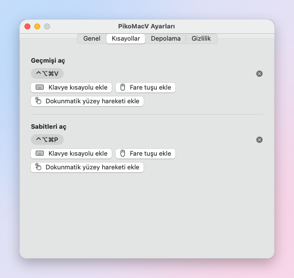
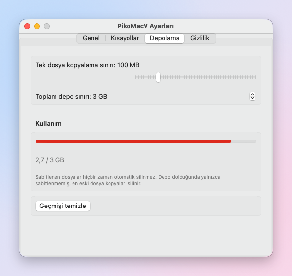

# PikoMacV kullanım kılavuzu

Bu kılavuz PikoMacV'nin tüm özelliklerini sırayla anlatır. Kurulum ve genel bakış için [README](../README.md), izinler ve veri saklama için [IZINLER.md](IZINLER.md) sayfasına bakın.

## İçindekiler

- [Paneli açmak ve kapatmak](#paneli-açmak-ve-kapatmak)
- [Sekmeler](#sekmeler)
- [Klavye kısayolları](#klavye-kısayolları)
- [Yapıştırma nasıl çalışır](#yapıştırma-nasıl-çalışır)
- [Sabitler](#sabitler)
- [Gizli sabitler](#gizli-sabitler)
- [Dosyalar ve dosya deposu](#dosyalar-ve-dosya-deposu)
- [Menü çubuğu](#menü-çubuğu)
- [Ayarlar](#ayarlar)
- [Tetikleyici eklemek](#tetikleyici-eklemek)
- [Zor bir kombinasyonu fare tuşuna bağlamak](#zor-bir-kombinasyonu-fare-tuşuna-bağlamak)

## Paneli açmak ve kapatmak

PikoMacV'nin iki modu vardır ve her birinin kendi tetikleyicileri olur:

- **Geçmişi aç:** paneli "Uygun" sekmesiyle açar.
- **Sabitleri aç:** paneli "Sabitler" sekmesiyle açar.

Panel fare imlecinin olduğu ekranda, imlecin hemen altında açılır; ekranın kenarına taşarsa içeri kaydırılır. Panel, o an önde olan uygulamanın odağını çalmaz; seçtiğiniz öğe o uygulamaya yapıştırılır. Panelin üst kısmında "Word için" gibi bir etiket, öğelerin hangi uygulama düşünülerek süzüldüğünü gösterir.

Paneli kapatmanın yolları: Esc, panelin dışına tıklamak, başka bir pencereye geçmek ya da aynı moddaki tetikleyiciye yeniden basmak. Panel ekran paylaşımında ve ekran kaydında görünmez.

## Sekmeler

Sıra soldan sağa: **Sabitler, Uygun, Metin, Görsel, Dosya, Tümü.** Arama kutusu en üsttedir; panel açılınca otomatik odaklanır, hemen yazabilirsiniz. Arama; metin içeriğinde, öğenin geldiği uygulamanın adında ve dosya adlarında çalışır. Sabitlerde etiket üzerinden aranır (gizli sabitlerde yalnızca etiket aranır).

| Sekme | Ne gösterir |
| --- | --- |
| Sabitler | Sabitlediğiniz öğeler. Önde olan uygulamaya uymayanlar gizlenir, listenin sonunda "Buraya uygun olmayan N öğe" satırı çıkar; ona tıklarsanız hepsi görünür |
| Uygun | Geçmişten, yalnızca önde olan uygulamaya yapıştırılabilecek öğeler. Uymayanlar için yine "Buraya uygun olmayan N öğe" satırı vardır; ona tıklayınca "Tümü" sekmesine geçilir |
| Metin | Metinler ve bağlantılar |
| Görsel | Görseller |
| Dosya | Dosyalar ve klasörler |
| Tümü | Her şey, süzmeden |

### "Uygun" sekmesinin kuralları

Uygunluk, önde olan uygulamanın türüne göre belirlenir. Uygulama türü, bilinen uygulamaların listesinden anlaşılır (örneğin Word, Excel, Notlar, TextEdit, Pages belge; Finder ve ForkLift dosya yöneticisi; Terminal, iTerm, Warp, Ghostty terminal; VS Code, Xcode, Zed ve JetBrains ürünleri kod editörü; Mail, Slack, WhatsApp, Teams gibi uygulamalar mesajlaşma; Safari, Chrome, Firefox gibi tarayıcılar). Listede olmayan uygulamalar "diğer" sayılır.

| Önde olan uygulama | Metin ve bağlantı | Görsel | Dosya |
| --- | --- | --- | --- |
| Belge uygulaması (Word, Notlar, ...) | Uygun | Uygun | Yalnızca tek bir görsel dosyaysa ("görsel olarak"); diğer dosyalar uygun değil |
| Dosya yöneticisi (Finder, ...) | Uygun değil | Uygun, dosya olarak yapıştırılır | Uygun |
| Terminal | Uygun, biçimsiz metin olarak | Uygun değil | Uygun, yol olarak |
| Kod editörü | Uygun | Uygun değil | Uygun, yol olarak |
| Mesajlaşma | Uygun | Uygun | Uygun, "ek olarak" |
| Tarayıcı ve diğerleri | Uygun | Uygun | Uygun |

Satırın altındaki küçük notlar ("dosya olarak", "yol olarak", "görsel olarak", "ek olarak") öğenin nasıl yapıştırılacağını söyler.

## Klavye kısayolları

Bunlar panel açıkken geçerlidir.

| Tuş | İşlev |
| --- | --- |
| ↑ / ↓ | Seçimi hareket ettirir; listenin sonunda başa sarar |
| Return | Seçili öğeyi yapıştırır |
| ⇧ Return | Metin ve bağlantıları biçimsiz (düz metin) yapıştırır |
| ⌘1 ... ⌘9 | Geçmiş sekmelerinde listedeki 1-9. satırı doğrudan yapıştırır |
| ⌥1 ... ⌥9 | Sabitler sekmesinde listedeki 1-9. satırı doğrudan yapıştırır |
| Tab | Sonraki sekme. Seçili satır "Buraya uygun olmayan N öğe" ise o satırı açar |
| ⇧ Tab | Önceki sekme |
| ⌘← / ⌘→ | Önceki / sonraki sekme |
| ⌘P | Seçili geçmiş öğesini sabitler (form açılır) |
| ⌘⇧P | Seçili metni gizli sabit olarak sabitler |
| ⌘N | Sıfırdan yeni bir sabit oluşturur |
| ⌘E | Seçili sabiti düzenler (yalnızca Sabitler sekmesi) |
| ⌘⌫ | Seçili öğeyi siler. Sabit ise önce onay sorar |
| ⌘, | Ayarlar'ı açar |
| Esc | Açık form varsa formu, yoksa paneli kapatır |

Satırların sağındaki ⌘1, ⌘2... ya da ⌥1, ⌥2... etiketleri, o satırın doğrudan yapıştırma tuşunu gösterir. Paneldeki alt çubuk da o sekmenin en sık kullanılan tuşlarını hatırlatır.

## Yapıştırma nasıl çalışır

Bir öğeyi seçtiğinizde PikoMacV şunları yapar: öğeyi, hedef uygulamaya uygun biçimde panoya yazar; hedef uygulamayı öne getirir; Erişilebilirlik izni varsa kısa bir bekleyişten sonra ⌘V basışını gönderir. İzin yoksa öğe panoda kalır ve ⌘V'yi siz basarsınız.

- **Metin ve bağlantılar:** biçimli (RTF) metin kopyalamışsanız biçim korunur. ⇧ Return ya da Terminal gibi hedefler biçimsiz yapıştırır.
- **Görseller:** PNG olarak yapıştırılır. Finder gibi dosya bekleyen uygulamalarda görsel, önbellekte (`~/Library/Caches/PikoMacV`) `PikoMacV-<tarih>.png` adlı bir dosyaya yazılıp dosya olarak yapıştırılır. Önbellekteki bu dosyalar 24 saatten eskiyse uygulama açılırken temizlenir.
- **Dosyalar:** özgün konumdaki dosya yapıştırılır; o yoksa PikoMacV'nin kendi kopyası kullanılır. Terminal ve kod editörlerinde dosyalar yol metni olarak (boşluk gibi özel karakterler kaçırılarak, birden çoksa boşlukla ayrılarak) yapıştırılır.
- Yapıştırdığınız öğe geçmişte en üste taşınır. Aynı içerik tekrar kopyalanırsa kopya oluşmaz, mevcut öğe en üste çıkar.
- Silinmiş ya da erişilemeyen bir dosyayı yapıştırmaya çalışırsanız bip sesi duyarsınız.

## Sabitler

Sabitler geçmişten bağımsızdır: geçmiş dolsa, silinse ya da temizlense de durur.

**Sabit oluşturmak**

- Geçmişteki bir öğeyi seçip ⌘P: bir form açılır, bir ad verirsiniz (varsayılan ad içeriğin ilk 30 karakteridir) ve kaydedersiniz. Metin, bağlantı, görsel ve dosyalar sabitlenebilir.
- ⌘N ile sıfırdan: ad ve içerik girersiniz. Örneğin "IBAN" ya da "Toplantı linki".
- Formdaki "Gizli (içerik görünmez)" anahtarı yalnızca metin ve bağlantılarda açılabilir.

**Sabitleri yönetmek**

- ⌘E ile ad ve içerik düzenlenir. Gizli sabitlerde içerik kutusu boş bırakılırsa mevcut gizli içerik değişmez.
- ⌘⌫ ile silinir; silmeden önce onay istenir. Gizli sabitlerde Anahtar Zinciri kaydı da silinir.
- Sabitlerin sırasını değiştirmek için bu sürümde bir arayüz yoktur; yeni sabitler listenin sonuna eklenir.

Sabitlenen görsel ve dosyalar kendi bağımsız kopyalarını tutar: geçmişten silinseler de sabit etkilenmez.

## Gizli sabitler

Parola, API anahtarı, IBAN gibi ekranda görünmesini istemediğiniz metinler için.

**Oluşturma:** geçmişteki bir metni seçip ⌘⇧P (ya da ⌘N ile yeni bir sabit oluşturup "Gizli" anahtarını açarak). Yeni bir gizli sabit yazarken içerik, ekranda noktalarla görünen bir parola kutusuna girilir.

**Saklama:** içerik sabitler dosyasına ve geçmişe değil, Anahtar Zinciri'ne yazılır. `pins.json` dosyasında yalnızca etiket vardır. Nasıl saklandığı [IZINLER.md](IZINLER.md#gizli-sabitler-nasıl-saklanır) sayfasında dürüstçe anlatılmıştır; orada belirtilen ödünleşimi bilerek kullanın.

Bir geçmiş öğesini ⌘⇧P ile gizli sabitlediğinizde özgün satır geçmişten kendiliğinden silinir; düz metin geçmişte kalmaz.

**Listede görünüşü:** satırda yalnızca etiket ve kilit simgesi vardır; içerik yerine "Xmqwo Rtkpa Znd" gibi bulanık, anlamsız bir yer tutucu ve "gizli" notu görünür.

**Yapıştırma:** satırı seçip Return'e basmanız yeterlidir. İçerik görünmeden, doğrudan yapıştırılır; bunun için Touch ID istenmez. Yapıştırılan değer panoda "gizli" işaretiyle durur (başka pano geçmişi uygulamaları bunu kaydetmesin diye) ve 30 saniye sonra panodan silinir. Süre, Ayarlar > Gizlilik'ten 10-120 saniye arasında değiştirilebilir. Bu sürede başka bir şey kopyalarsanız PikoMacV panoya dokunmaz.

**Görmek:** satırın sağındaki göz simgesine tıklayın. Touch ID (ya da cihaz parolası) sorulur. Doğrulama geçerliyse içerik yavaşça netleşir ve 10 saniye sonra kendiliğinden yeniden gizlenir; göz simgesine tekrar basarak da hemen gizleyebilirsiniz. Panel kapanınca gösterilen içerik bellekten silinir.

**Oturum süresi:** başarılı bir doğrulamadan sonra belirli bir süre boyunca tekrar sorulmaz. Varsayılan 2 saattir; Ayarlar > Gizlilik'te 15 dakika, 1 saat, 2 saat ya da 8 saat seçebilirsiniz. Uygulama kapanınca oturum da biter.

**Geçmişe girmez:** gizli sabitler geçmişe kaydedilmez; pano gizli işaretli olduğu için PikoMacV'nin kendi izleyicisi de yapıştırdığınız değeri geçmişe almaz.

## Dosyalar ve dosya deposu

Bir dosya ya da klasör kopyaladığınızda (örneğin Finder'da ⌘C) PikoMacV yolunu kaydeder. Dosyanın boyutu izin verilen sınırı aşmıyorsa arka planda bir kopyasını da `~/Library/Application Support/PikoMacV/vault` klasörüne alır. Böylece özgün dosya taşınsa ya da silinse bile yapıştırabilirsiniz.

| Kural | Varsayılan | Ayarlanabilir aralık |
| --- | --- | --- |
| Tek dosya kopyalama sınırı | 100 MB | 10-500 MB |
| Toplam depo sınırı | 3 GB | 1-20 GB |

- Sınırı aşan dosyaların ve klasörlerin kopyası tutulmaz; yalnızca yolu hatırlanır. Özgün dosya orada durdukça yapıştırılabilir.
- Depo sınırı aşılınca, en eski geçmiş öğelerinden başlayarak kopyalar silinir. Öğenin kendisi geçmişte kalır; yalnızca kopyası gider.
- **Sabitlenmiş dosyalar asla otomatik silinmez.** Ama toplam kullanıma dahildirler.
- Depo kullanımı panelin altında bir çubuk ve "2,7 / 3 GB" gibi bir yazıyla görünür.

### Renk ipuçları

Depo yüzde 60'ı geçince silinmeye aday kopyalı satırların arkasında yarı saydam kırmızı bir zemin belirmeye başlar. Depo doldukça ve satır silinme sırasına yaklaştıkça kırmızı koyulaşır; sıradaki en yakın aday için satırda ayrıca "sırada silinecek" yazar. Alt çubuktaki kullanım çubuğu yüzde 60-85 arasında turuncu, yüzde 85'in üzerinde kırmızıdır. Silinmesini istemediğiniz dosyayı ⌘P ile sabitleyin.

Dosya kopyası olmayan satırlar (metin, kopyası tutulmayan büyük dosyalar) bu uyarıyı hiç göstermez.

Bir dosyanın hem özgün hâli hem kopyası yoksa satır soluklaşır, "dosya bulunamadı" yazar ve yapıştırılamaz.

## Menü çubuğu

Menü çubuğundaki pano simgesine tıklayınca şu seçenekler çıkar: Geçmişi aç, Sabitleri aç, Ayarlar…, Kurulum sihirbazı…, Geçmişi temizle (sabitler korunur, geri alınamaz) ve PikoMacV'den çık. Hiç tetikleyici tanımlamadıysanız paneli buradan açabilirsiniz.

## Ayarlar

Ayarlar'ı menü çubuğu simgesinden ya da panelde ⌘, ile açın. Dört sekme vardır.

### Genel

- **Geçmiş sınırı:** 100 ile 1000 arasında, 50'şer artarak. Varsayılan 200. Sınır aşılınca en eski öğeler silinir.
- **Oturum açılışında başlat:** Mac'inize giriş yaptığınızda PikoMacV kendiliğinden başlar. İmzasız ya da ad-hoc imzalı sürümlerde macOS bunu reddedebilir.
- **Yok sayılan uygulamalar:** Buradaki uygulamalardan yapılan kopyalamalar geçmişe alınmaz. "Uygulama ekle…" ile bir uygulama seçersiniz.

### Kısayollar

"Geçmişi aç" ve "Sabitleri aç" için ayrı tetikleyici listeleri bulunur. Her listeye istediğiniz kadar tetikleyici ekleyebilirsiniz; bir tetikleyici yalnızca tek bir moda atanabilir. Erişilebilirlik izni yoksa en üstte bir uyarı ve "İzin ver" düğmesi görünür. Ayrıntılar bir sonraki bölümde.

### Depolama

- **Tek dosya kopyalama sınırı:** 10-500 MB, 10'ar MB'lık adımlarla.
- **Toplam depo sınırı:** 1-20 GB.
- **Kullanım:** doluluk çubuğu ve "Sabitlenen dosyalar hiçbir zaman otomatik silinmez" notu.
- **Geçmişi temizle:** onay sorar, sabitleri korur, geri alınamaz.

### Gizlilik

- **Gizli oturum süresi:** 15 dk, 1 sa, 2 sa (varsayılan), 8 sa.
- **Gizli öğe panodan N sn sonra silinir:** 10-120 saniye, varsayılan 30.
- Bilgi notları: gizli içerik Anahtar Zinciri'nde saklanır; PikoMacV ekran paylaşımında görünmez; parola yöneticilerinden kopyalananlar kaydedilmez.

## Tetikleyici eklemek

Üç tür tetikleyici vardır. Hepsi Ayarlar > Kısayollar'dan (ve kurulum sihirbazından) eklenir.

### Klavye kısayolu

"Klavye kısayolu ekle" düğmesine basın ve istediğiniz tuş kombinasyonunu girin (iptal için Esc). Kayıt sırasında diğer tetikleyiciler geçici olarak durdurulur. Kısayol hemen kontrol edilir:

- Sistem kısayollarıyla çakışıyorsa (Spotlight, Mission Control, ekran görüntüsü, girdi kaynağı değiştirme vb.) "Sistem kısayolu: ..." uyarısı çıkar.
- ⌘C, ⌘V, ⌘Q gibi çok kullanılan uygulama kısayollarıyla çakışıyorsa uyarı çıkar.
- Başka bir uygulama o kombinasyonu zaten kaydettiyse "Başka bir uygulama tarafından kullanılıyor" uyarısı çıkar; böyle bir kısayol kaydedilemez.

Kurulum sihirbazında, boş olan kombinasyonlar öneri olarak sunulur (⌃⌥⌘V ve ⌃⌥⌘B gibi). Önerilere tıklayarak ekleyip çıkarabilirsiniz. Klavye kısayolları Erişilebilirlik izni gerektirmez.

### Fare tuşu

"Fare tuşu ekle"ye basın ve 8 saniye içinde fareniz üzerindeki bir tuşa basın. Orta tuş "Orta fare tuşu", yan tuşlar "Fare tuşu 4", "Fare tuşu 5" gibi görünür. Sol ve sağ tuşlar atanamaz.

Bilmeniz gerekenler:

- Fare tuşu tetikleyicileri Erişilebilirlik izni ister. İzin yoksa listede uyarı görünür.
- Atanan tuşun normal işlevi (ör. tarayıcıda geri/ileri) tüm sistemde devre dışı kalır; tuşa basış PikoMacV tarafından yutulur. Bunu istemiyorsanız yan tuşlarınızdan kullanmadığınızı seçin.

### Dokunmatik yüzey: üç parmakla çift dokunma

Bu seçenek yalnızca Mac'inizde uygun bir dokunmatik yüzey bulunuyorsa görünür. Teknik not: hareketi algılamak için Apple'ın belgelenmemiş MultitouchSupport çerçevesi çalışma anında yüklenir. Bu yüzden seçenek isteğe bağlıdır ve eklenmeden önce bir **canlı test** gerekir:

1. "Dokunmatik yüzey hareketi ekle"ye basın.
2. 10 saniye içinde dokunmatik yüzeye üç parmakla iki kez hızlıca dokunun.
3. Hareket algılanırsa "Hareket algılandı" görünür ve tetikleyici eklenir. Algılanamazsa "Hareket algılanamadı" uyarısı çıkar ve "Tekrar dene" sunulur; test iki kez üst üste başarısız olursa seçenek o pencere için gizlenir.

Dokunma tek parmak hareketi sayılmaz: üç parmak birlikte kısa süre dokunup bırakmalı ve ardından hızla yeniden dokunmalıdır; fazla kayan ya da uzun süren dokunuşlar sayılmaz. Hareket tüm bağlı dokunmatik yüzeylerde dinlenir. Bu tetikleyici yalnızca tek bir moda atanabilir; ikinci bir moda eklerseniz öncekinden kaldırılır. Test sonuçları tanılama için `~/Library/Application Support/PikoMacV/trackpad-test.log` dosyasına yazılır. Bir macOS güncellemesi sonrası hareket çalışmaz hâle gelirse diğer tetikleyicilerin etkilenmediğini unutmayın.

## Zor bir kombinasyonu fare tuşuna bağlamak

Fareniz sıradan bir fare ise yan tuşlar zaten doğrudan "Fare tuşu ekle" ile atanabilir. Fareniz özel bir yazılımla geliyorsa (Logitech Options+, Razer Synapse, SteerMouse, BetterMouse vb.) şu yolu da deneyebilirsiniz:

1. Ayarlar > Kısayollar'da PikoMacV için, kazara basılması neredeyse imkânsız bir kombinasyon ekleyin; örneğin ⌃⌥⌘⇧V gibi dört değiştirici tuşlu bir kombinasyon ya da F13-F19 gibi fiziksel klavyede bulunmayan bir tuş.
2. Fare yazılımınızda, kullanmak istediğiniz tuşa bu kombinasyonu atayın.

Böylece tuşa basınca fare yazılımı kombinasyonu gönderir ve PikoMacV açılır. Bu yolun üstünlüğü, PikoMacV'nin Erişilebilirlik iznine ve fare tuşlarını yutan bir olay dinleyicisine ihtiyaç duymamasıdır. Kurulum sihirbazındaki not da aynı şeyi önerir: fare tuşuna atayacaksanız zor bir kombinasyon seçin.
